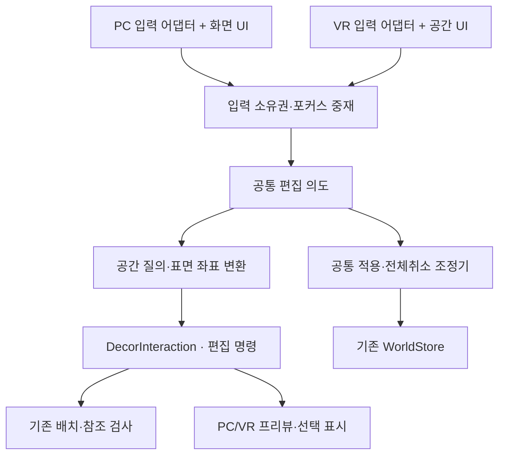

# PC·VR 공통 꾸미기 조작 계약

2026-10-18 · DECOR-13 설계 개정. 사용자가 PC와 VR 모두에서 같은 꾸미기 기능을 사용하도록 명시했다. 기존 문서의 PC 전용 우선·VR 편집 제외 조항보다 이 계약을 우선한다. 이 문서는 구현 계획이며 VR 구현·실기기 검증 완료를 뜻하지 않는다.

## 1. 제품 범위와 현재 상태

- PC: 마우스·키보드와 화면 버튼. 키보드는 빠른 조작 수단이며 모든 편집 기능에 화면 버튼 경로를 둔다.
- VR: PC 연결 Quest Link, 양손 컨트롤러 레이·버튼·스틱과 공간 메뉴. 키보드·모니터를 보지 않고 전체 꾸미기 흐름을 마칠 수 있어야 한다.
- 양쪽에서 같은 카탈로그·소유 개체·편집 명령·충돌 검사·보관·Undo/Redo·적용/취소·저장을 사용한다. 모드별 world 파일이나 다른 소유 수량을 만들지 않는다.
- standalone, 손 추적, 두 손으로 크기 변경, 네트워크 공동 편집은 후속이다. VR에서 방 안을 직접 돌아다니며 레이로 배치하는 방식을 첫 기준으로 삼고 강제 상단 시점은 사용하지 않는다.
- 01~07은 통합(PR60 포함),13 설계도 PR61로 통합했다.14 공통구조는67검사·전체회귀를 통과했고 새 PC/VR뷰·실제Physics·Quest착용검증은 후속이다. PC 합성 입력의 105검사를 VR 지원 근거로 쓰지 않는다. 사용자 확인을 다섯 장면 전부의 실측으로 확대하지 않는다.

## 2. 구조와 책임

현재 `DecorInputRouter`는 PC 장치와 단축키, `DecorEditorController`는 화면 포인터와 카메라 레이, `DecorPanel`은 UI Toolkit과 도형 생성을 함께 다룬다. 현재 구현이 이미 입력 독립이라고 가정하지 않는다. `DecorInteraction`·기존 DTO·명령·validator·WorldStore는 재사용하고, 위 Unity 경계부터 단계적으로 분리한다.

다음 이름은 DECOR-14~16에서 만들 예정인 계약 이름이다. 기존 파일이 있으면 카드 착수 시 확인한다.

| 책임 | 예정 구성 | 맡지 않는 일 |
|---|---|---|
| 편집 의도·포커스/소유권 | DecorInputCoordinator | 키보드/컨트롤러 직접 읽기, 파일 쓰기 |
| PC 장치 해석 | DecorPcInputAdapter | 직접 Transform 변경, 도메인 명령 우회 |
| VR 장치 해석 | DecorVrInputAdapter | 별도 저장/충돌 로직 |
| 월드 레이·작은 물건 선택 | DecorWorldPointer | 화면 좌표를 공통 API로 강제 |
| UI 데이터·조작 가능 상태 | DecorEditorPresenter | 특정 UI 위젯 참조 |
| PC 표시 | 기존 DecorPanel에서 분리한 화면 뷰 | 영구 상태 소유 |
| VR 표시 | DecorVrPanelView | 별도 카탈로그/보관함 계산 |
| 적용·전체취소 | 07 저장 조정기를 호출하는 공통 세션 | UI별 Commit 구현 |

공통 입력 봉투는 `sessionToken, source(PC/VR), pointerId, sequence, phase(Started/Changed/Performed/Cancelled), intent, payload`를 갖는다. 같은 source/sequence 재전달은 한 번만 처리한다. world/명령 DTO에 이 장치 정보를 저장하지 않는다. 실제 변경 명령 ID는 중재기가 확정 동작당 한 번 발급한다.

포인터는 화면 픽셀이 아닌 `rayOriginM, rayDirection, tracked, maxDistanceM` 또는 이미 검증한 `instanceId/surfaceId + 후보위치`로 전달한다. PC만 카메라의 ScreenPointToRay를 사용한다. VR은 컨트롤러 월드 레이를 사용한다. 방·부모 로컬좌표 변환과 1mm 정규화는 공통 질의 뒤 기존 geometry 규칙을 따른다.

공통 의도는 Select, BeginPlace, BeginMove, UpdateTarget, ConfirmPlacement, CancelPreview, ClearSelection, RotateStep, Store, SetVariant, SampleDefinition, Undo, Redo, SetSnap, SetRepeat, CycleTarget, Apply, RequestDiscard, ConfirmDiscard, ResumeEdit이다. UI는 이 의도를 호출한다. UI 위젯 인스턴스를 입력 API에 전달하지 않는다. 일반 취소는 프리뷰→선택→전체취소 요청 순서이며 ConfirmDiscard와 구분한다. 방/선택 맞춤·그리드·벽 보기·메뉴 열기는 표시 의도로 별도 취급한다.

### 2.1 이벤트와 결과 세부 규칙

sequence는 제스처 번호가 아닌 source 전체의 단조 증가 이벤트 번호다. 두 손도 같은 VR 카운터를 공유한다. Started/Changed/Performed는 서로 새 번호를 갖고 같은 이벤트 재전달만 같은 번호를 쓴다. 누른 상태를 매 프레임 새 Performed로 변환하지 않는다. sessionToken은 입력 활성 세대이며 모드 전환·pause 복귀 때 갱신해 오래된 큐를 거절한다. 편집 초안·Undo·저장 revision을 새로 만드는 의미가 아니다.

처리 결과는 Accepted/NoChange/Rejected, reasonCode, previewValid, selectionId, capabilities로 반환한다. 두 뷰는 같은 capabilities로 버튼을 활성화하고 reasonCode를 한글로 매핑한다.

| 의도 | 필수 payload·조건 |
|---|---|
| Select/SampleDefinition | tracked ray 또는 공통 질의가 검증한 instanceId. UI 소비·가림 검사 우선 |
| BeginPlace | definition ID+version, variant, 신규/보관 출처. 보관이면 기존 rootId 필수 |
| BeginMove/Store | 선택 instanceId. 기존 부모·자손 계약 유지 |
| UpdateTarget | ray 또는 surfaceId+후보 pose, snap 상태. 프리뷰 소유 포인터만 허용, 명령 없음 |
| ConfirmPlacement | pointerId와 마지막 후보 token. 같은 입력 tick에서 유효성 재검사 후 명령1개 |
| RotateStep | 방향 -1/+1. 프리뷰면 미리보기만, 선택물이면 기존명령1개 |
| SetVariant | 현재 정의에 존재하는 variantId |
| SetSnap/SetRepeat/CycleTarget | bool 또는 방향 -1/+1. 도구 상태만 변경 |
| Undo/Redo/CancelPreview/ClearSelection | 추가 payload 없음. 세션의 허용 상태 확인 |
| Apply/RequestDiscard/ConfirmDiscard/ResumeEdit | 필요 시 확인창 token.07 저장 조정기 호출, 오래된 확인창 token 거절 |

VR도 PC와 동일한 시험판 제품 저장 루트를 사용한다. 별도 VR 제품명 때문에 저장 파일이 갈라지게 하지 않는다. 동시에 실행한 두 프로세스는 기존 writer lock을 공유하고 두 번째는 읽기전용이다. 단일 프로세스 모드 전환 때는 writer와 편집 세션을 유지하며 중복 Commit을 하지 않는다.

## 3. 기능 동등성과 기본 입력

오른손을 기본 주 손으로 하며 왼손 설정은 주/보조 손 역할을 통째로 바꾼다. 아래 물리 버튼은 첫 Quest Touch 프로필 기본안이며 구현 시 설치된 OpenXR/Input System 바인딩으로 확인한다. 모든 조합의 대체 버튼을 메뉴에 제공한다. 시스템 예약 Menu/Oculus 버튼을 필수 조작에 쓰지 않는다.

| 기능 | PC | VR 기본 | 공통 메뉴 대체 |
|---|---|---|---|
| 선택·프리뷰 놓기·UI 클릭 | 왼쪽 클릭 | 주 손 트리거를 누른 순간 1회 | 선택/놓기 |
| 기존 물건 이동 | M | 선택 메뉴의 이동 | 이동 |
| 회전 | Q/E | 프리뷰 또는 선택 상태에서 주 손 스틱 좌우 | 좌/우 회전 |
| 프리뷰 취소·선택 해제 | Esc | 주 손 보조 버튼(B, 왼손이면 Y) | 취소/선택 해제 |
| 편집 메뉴 열기·닫기 | 도구 버튼 | 보조 손 보조 버튼(Y, 왼손이면 B) | 메뉴 닫기 |
| 회수·부모 선택·색상·스포이트 | Delete/I 및 정보판 | 레이로 선택 메뉴 클릭 | 각각 별도 버튼 |
| Undo/Redo | Ctrl+Z/Y | 레이로 도구 메뉴 클릭 | 되돌리기/다시 실행 |
| 눈금·맞춤 해제 | G/Alt | 도구 메뉴에서 보기/맞춤 전환 | 눈금, 맞춤 켜기/끄기 |
| 새 물건 연속 놓기 | Shift+놓기 | 연속 놓기 토글 후 트리거 | 연속 놓기 |
| 적용·전체 취소·다시 꾸미기 | Ctrl+S 및 버튼 | 레이로 공통 메뉴 클릭 | 세 버튼 모두 |
| 후보 순환·작은 소품 선택 | Tab/후보 버튼 | 레이 후보 목록·다음 후보 | 이전/다음 후보 |
| 검색 | 검색칸 입력 | 공간 검색 키보드·검색 지우기 | 종류 필터·검색 지우기 |

트리거를 누른 채 프레임이 지나거나 UI에서 방으로 레이가 벗어나도 새 놓기가 발생하지 않는다. 연속 배치도 매번 놓기 버튼을 뗀 뒤 다시 눌러야 한다. 이동 중 손을 놓는 동작으로 자동 저장/회수하지 않는다. grip을 관람용 물건 잡기와 혼용하지 않는다.

회전은 기존 90도만 지원한다. VR 손목 기울기나 스틱으로 자유 yaw를 도입하지 않는다. 스틱 회전 기본 deadzone .6, 중립 복귀 .3, 한 번 넘을 때 한 단계이며 길게 눌러 반복하지 않는다. 값은 사용자 설정 후보로 분리한다. 비프리뷰 선택 상태에서도 물건이 선택되어 있으면 회전을 우선하고, 선택이 없을 때 주 손 좌우는 몸 방향 30도 스냅 회전으로 쓴다. 물건 선택을 해제하면 이동/시점 회전으로 돌아간다는 안내를 표시한다.

VR 이동은 보조 손 스틱으로 안전 바닥 텔레포트 후보를 띄우고 중립으로 복귀할 때 유효 위치만 이동한다. 프리뷰 중 텔레포트는 우선 차단하고 현재 프리뷰를 확정/취소하도록 안내한다. 연속 부드러운 카메라 이동·강제 카메라 회전·인위적 줌은 첫 기본값에 넣지 않는다. 실제 이동·머리 추적은 편집 중에도 유지한다. PC의 궤도 카메라는 VR 카메라 Transform을 덮어쓰지 않는다.

## 4. UI·레이·작은 물건

PC는 기존 UI Toolkit 화면을 유지한다. VR은 월드 공간 Canvas/uGUI와 기존 설치 XRI 레이 UI 경로를 첫 선택으로 사용한다. 새 유료 패키지는 도입하지 않는다. 실제 XRI UI 클릭/한글 입력 호환은16의 첫 기술 검사다. 스크린 UI를 평면 이미지로만 붙여 놓고 VR 조작 지원이라 부르지 않는다. 다른 UI 경로가 필요하면 최소 재현과 ADR로 계약을 갱신한다.

VR 메뉴는 열 때 보조 손 앞/시선 기준 약1m에 배치하고 월드 공간에 고정한다. 머리에 계속 붙이지 않는다. 패널 위치 재맞춤·닫기를 제공한다. 초기 폭 .65m, 버튼 hit 영역 높이 시작값 .045m(거리1m 기준), 본문 .007m를 출발값으로 두되 .8~1.2m에서 한글 가독성·선택 실패·팔 피로를 실기기로 조정한다. 수치를 검증된 접근성 보장으로 기록하지 않는다. 긴 카탈로그는 페이지/스크롤, 한글 이름 줄바꿈, 카테고리·선택정보 접기를 제공한다. 가상 키보드가 활성화되면 두 손의 편집/이동 키를 소비하며 저장 단축 동작을 전달하지 않는다. 검색창 닫기와 적용은 별도 버튼이다.

UI가 맞으면 UI가 입력을 소비하고 뒤의 물건은 선택/배치하지 않는다. 확인창→텍스트 입력→공간 UI→편집 월드→이동 순서로 소유권을 결정한다. 프리뷰 소유 손과 UI 포인터도 중재한다. 반대 손은 메뉴를 쓸 수 있지만 동일 프레임에 두 손이 확정 명령을 보내지 못한다.

12cm 꽃병을 위한 선택 보조는 ray 근처 후보 하이라이트와 명시적인 후보 목록이다. 부모 자동 선택·보이지 않는 소품 관통·벽 너머 선택을 허용하지 않는다. 기본 각도 보조 .75도/추가폭 최대 .03m, 레이길이 최대8m는 설정 후보다. 가장 앞의 가림 면 안쪽 후보만 제시한다. 후보 ID와 선택 표시를 일치시키고, 배치 위치는 보조 포인터가 아닌 실제 표면 레이 결과로 계산한다. 유효/오류는 색과 짧은 이유를 함께 표시한다. 햅틱은 선택적 보조이며 단독 오류 안내로 쓰지 않는다.

## 5. 입력 소유권·장치 전환·중단

한 편집 세션·한 입력 소유자만 활성화한다. 모니터에 VR 미러가 보여도 PC 카메라·마우스는 월드 명령을 동시에 보내지 않는다. 시작 옵션/화면 메뉴의 PC·VR 선택으로 모드를 정하며 컨트롤러가 움직였다는 이유만으로 자동 전환하지 않는다. PC 모드에서 XR 장치가 없어도 실행 가능해야 한다.

전환 요청→프리뷰만 취소→입력 큐/누름 상태 비우기→기존 action map 비활성→새 뷰·입력 준비→모든 확정 버튼 release 확인→재개 순서다. 확정된 초안·Undo/Redo·선택 ID·보관·저장 revision은 유지한다. 미리보기 취소를 명령이나 Apply로 만들지 않는다. 새 뷰 준비 실패 시 기존 모드로 돌아가며 초안을 지키고 이유를 알린다. XR 시작/종료 방식은16에서 현재 부트스트랩에 연결하고 모드 전환 버튼만으로 지원됐다고 주장하지 않는다.

컨트롤러 추적 상실·앱 포커스 상실·HMD 벗음은 PauseInput으로 처리한다. 확정 입력을 막고 프리뷰만 취소하며 초안은 유지한다. 추적 복귀만으로 동작을 재생하지 않고 버튼을 놓은 뒤 재개한다. PC로 계속 편집하거나 전체 취소할 수 있는 복구 안내를 제공한다. 저장/활성화 중에는 모드 전환·중복 적용을 막고 결과가 난 뒤 복구한다. 저장 후 활성화 실패는07과 동일하게 저장 사실을 알리고 양쪽 모두 오래된 화면을 편집하지 못하게 한다.

관람 action map/기존 `VRExhibitInteraction` 물건 복사본 잡기·돌려놓기는 꾸미기 중 비활성화한다. 편집 종료 시 해당 상태를 정상 복원한다.16에서는 가상 시험방 경계를 검증하고 실제 NPC 정지/복원과 자료 이전은08에서 추가한다.

## 6. 구현과 검증을 교차하는 계획

기존 번호를 바꾸지 않고13~17을07과08 사이에 삽입한다. 번호는 실행 순서가 아니며 의존성이 정본이다. 각 카드의 구현 뒤 검증·검토를 거친 다음 카드로 진행한다.

| 순서 | 작업 | 검증·종료 조건 |
|---|---|---|
| 0 | 07 사용자 확인 기록·별도 커밋/CI/통합 | PC 시험 저장 근거 유지, VR 완료로 바꾸지 않음 |
| 1 |13 이 설계·기존문서·작업카드 개정 | 문서 링크/의존성/충돌 검토. 게임 구현 없음 |
| 2 |14 공통 의도·포인터·입력중재·Presenter 경계 추출 | 입력 중복/취소/큐폐기·동일 의미 결과·기존 순수 회귀 |
| 3 |15 PC 어댑터/화면 연결 | 기존 Player105 재현과 마우스 전용 기능경로·Ctrl+S 포커스 회귀 |
| 4 |16 VR 어댑터·공간 UI·Link 시험방 연결 | 레이/UI 기술검사 먼저, 자동 XR 입력/모드 중단 검사 후 실제 표시 |
| 5 |17 PC·Quest Link 사용자 검증 | 양쪽 다섯 장면·모드전환·재실행·사용감/성능 실측 |
| 6 |08 실제앱 연결 설계→09/10 계약·하위구현→11 통합→12 최종검토 | PC·VR 기능동등성 유지, 실제 관람객·자료 보존 재검증 |

## 7. 인수 행렬

각 행에 순수 자동검사, PC 합성 Player, 실제 PC 마우스, XR 합성/시뮬레이션, Quest Link 착용·컨트롤러 결과를 분리해 기록한다. 성공/실패/미실행과 로그·기기·설정·담당을 적는다. 기기가 없으면 문서/자동검사는 계속하되17과 실제 양쪽 지원 완료 표시는 보류한다.

| 장면 | 양쪽 기대 결과 |
|---|---|
| 전시대 놓기·색상 | ID 한 개, 같은 variant·수량 |
| 꽃병 놓기·5cm 이동·Undo | 꽃병만 선택, 유효 상판·부모 유지, Undo 한 번 |
| 부모 이동·회전 | 동일 자식 ID·로컬위치·상대회전 보존 |
| 회수·보관함 재설치 | 같은 ID·색상·자손, 복제 없음 |
| 문 앞 거절→수정→적용·재실행 | 거절은 무변경, 수정본·revision·부모관계 일치 |
| UI/검색/확인창 위 입력 | 뒤의 방·가구·텔레포트에 누출 없음 |
| 연속 입력·두 손 동시 확정 | 한 번 누름당 명령 한 개, 중복 ID 없음 |
| 추적 상실·재연결·PC↔VR | 유령 놓기 없음, 초안·Undo·저장 불변 |
| 준비/저장/활성화 실패·읽기전용 | 안내와 실제 디스크 상태 일치, 양쪽 재로딩 |

입력 좌표 자체가 다른 PC·VR을 비트 단위로 같다고 요구하지 않는다. 결정적인 후보좌표와 같은 의도를 공급한 자동 fixture에서는 world 의미·명령 수·Undo 수를 비교하고, 손 조작은 동일 snap 목표와 ID·참조 불변을 검사한다. 프레임 P50/P95·최대중단, 반응 지연, 작은 꽃병 선택 실패와 재시도, 메뉴 가독성·멀미/피로 의견을 각 모드에서 남긴다. 90도 물건 회전과30도 몸 회전을 혼동하지 않는지도 확인한다. 성능 합격 수치는 실제 장비 기준 측정 후 승인하며 근거 없이 지원 FPS를 정하지 않는다.

## 8. 후속 Gate에 적용

08은 양쪽의 편집 진입/종료·입력map·관람 복사본·NPC 정지/복원 책임표를 포함한다.09/10의 새 소장품·조명·마감 도구는 공통 의도와 양쪽 UI를 함께 명세한다.11은 실제 저장을 PC에서 편집→VR에서 복원·수정→PC에서 재확인하는 회귀를 수행한다.12는 두 환경의 사용자 의견을 따로 기록한다. 키보드 전용 신규 기능이나 별도 VR 저장 정본을 도입하려면 계약 변경으로 재검토한다.

## 9. Meta 원칙 우선 적용 (2026-10-18 보강)

[Meta 원칙·적용·인수기준](07-Meta-원칙과인수기준.md)의M01~M08을 적용한다. 이 보강의 거리/시야각·hit영역·조기실기기 Gate가 기존 패널 크기 초깃값보다 우선한다. 손 추적 권고와 컨트롤러의 자체 초깃값을 구분한다.16은 최소 패널·꽃병의 실제 착용 확인 후 나머지 VR메뉴를 확장하고17은P0항목 미검증 시 완료하지 않는다.

## 2026-10-18 사용자 승인 · 편집 화면/입력 재구축
기존 PC 패널에 VR 분기를 추가하는 대신 단일 공통 편집 세션 위에 새 PC 뷰와 새 VR 뷰를 작성한다. 아이템/명령/충돌/저장 코어와 기존 시험판은 유지한다.14는 별도 작업폴더에서 공통 세션·입력중재·월드질의·Presenter 첫 구현 및 모의 입력67검사/전체CI를 완료했다. 실제Physics/새UI/Quest검증은 미완료다.15는 새 최소PC화면·입력·Physics어댑터,16은 같은세션의 최소VR패널·컨트롤러를 연결한다. 꽃병 단일 흐름을 양쪽에서 확인한 뒤 카탈로그를 확장한다. 기존 패널 연결/수정을 전제로 한 위 예정 영역은 비교·회귀 참고이며 새 구현 경로는각인계에기록한다.07/13원본 미커밋을 보존하며 통합순서는07→13→14다. 사용자 시작 지시에 따라14개발을 선행했으나통합이나VR완료로간주하지않는다.
