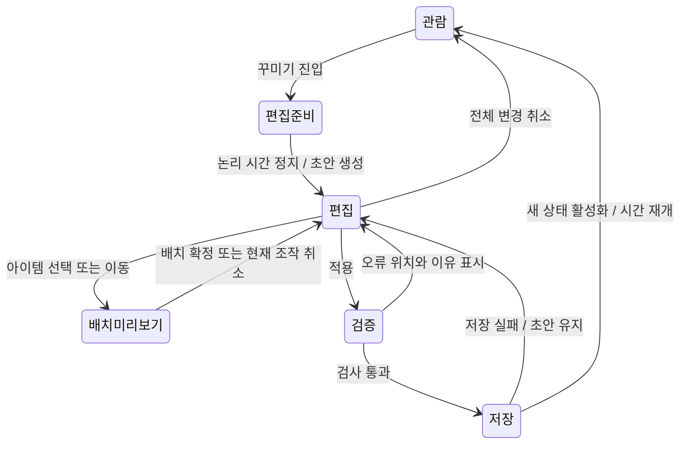
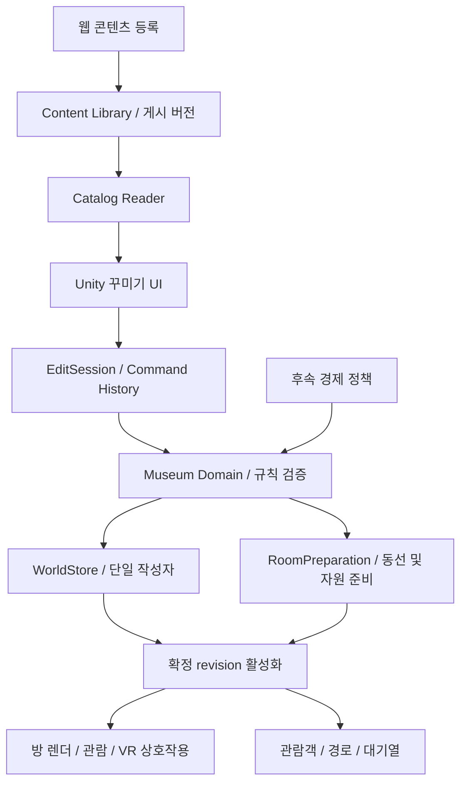
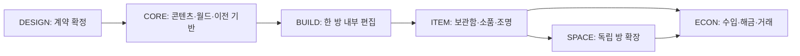

# 박물관 아이템 관리와 내부 꾸미기 아키텍처

**설계안 v1.0 · 2026-10-17 · 사용자 검토용**

> 구현 위임용 후속 명세: [심즈식 박물관 꾸미기 개발명세](박물관-꾸미기-개발명세/README.md). 사용자가 세부 기본값 결정을 위임하여 화면·입력·아이템 관리 기준, 첫 시험판의 스키마·예시 데이터와 12개 작업 카드를 구체화했다. 공통 계약과 기본 조작에서 겹치는 내용은 후속 명세를 따른다. 첫 7개는 순차 구현용이며, 이후 확장은 설계 검토 Gate로 구분한다.

목적: 심즈 4의 건축·구매 경험을 참고하여, 독립된 이공간 전시실에서 아이템을 체계적으로 등록·보관·배치하고 향후 관람료·해금·확장으로 발전시킬 구조를 정의한다.

이 문서는 구현을 시작하기 위한 설계 제안이다. 사용자 방향, 코드에서 확인한 현행 사실, 설계 선택, 실측이 필요한 수치를 구분한다. 게임 기능 구현·개인 자료 이전·GitHub 통합은 아직 수행하지 않았다. 앞선 「박물관-꾸미기-설계초안.md」의 후속 문서이며, 서로 충돌하면 이 문서의 설계안을 우선 검토한다.

## 읽는 순서

- 제품 경험과 핵심 결정: 1~4장
- 아이템·배치·공간 데이터: 5~9장
- 프로그램 경계·저장·관람객 연결: 10~14장
- 기존 자료 이전·개발 순서·합격 기준: 15~18장
- 미확정 사항과 근거: 19~20장

## 1. 사용자 방향과 이번 설계의 결론

### 1.1 사용자에게서 확인된 방향

1. 당분간 관람객의 신규 기능보다 박물관의 공간·전시 완성도에 집중한다.
2. 웹 관리 화면은 소장품과 에셋 등록을 맡고, 배치는 박물관 내부에서 한다.
3. 심즈 4와 유사하게 목록에서 물건을 골라 배치하고 꾸민다.
4. 방은 독립된 이공간이다. 문으로 연결되면 충분하며, 하나의 연속된 건물은 필요하지 않다.
5. 복셀처럼 계산 가능한 격자 기준을 사용하되, 꽃병·조명 등 작은 물건도 세밀하게 배치할 수 있어야 한다.
6. 장기적으로 관람객 입장 → 관람료 → 아이템 해금·구매 → 공간 확장을 연결한다.
7. 개발 단계에 앞서 아이템 관리 체계와 아키텍처를 정의한다.

### 1.2 설계안의 주요 선택

| 항목 | 제안한 기준 | 이유 |
|---|---|---|
| 공간 | 독립 Room + 문 연결 | 현재 방별 로딩을 발전시키며 이공간 설정 유지 |
| 구조 | 하나의 앱 내부에서 역할을 나눈 모듈 구조 | 별도 클라우드나 여러 서버 없이 시작 |
| 아이템 | 정의 / 소유 인스턴스 / 배치 참조 분리 | 구매·회수·복제·색상 변경의 의미를 명확하게 함 |
| 소장품 | 고유 기록 + 일반 아이템과 구분되는 전시 연결 | 개인 소장품의 원본과 대사 보존 |
| 격자 | 바닥 1m, 가구 25cm, 소품 5cm 맞춤 | 크기 이해와 섬세한 배치를 동시에 지원 |
| 좌표 저장 | 방 로컬 미터 좌표 | 맞춤 간격 변경과 기존 좌표 보존에 유리 |
| 높이 | 바닥·벽·천장·가구 표면에 부착 | 작은 소품을 바닥 칸에 억지로 끼우지 않음 |
| 저장 소유자 | 웹은 콘텐츠, Unity 앱은 박물관 상태 | 웹 서버 없이 내부 꾸미기 저장 가능 |
| 적용 | 편집 초안에서 검증 후 한 번에 확정 | 배치·보관함·미래 자금을 일관되게 저장 |
| 초기 시간 | 꾸미기 동안 전체 관람객 논리 시간 정지 | 다른 방·대기열·수입과 충돌 방지 |
| 경제 | 초기 무료 꾸미기, 경제 정책은 후속 모듈 | 배치 기능에 가격·해금을 직접 섞지 않음 |

위 수치와 조작 방식은 설계 기본안이다. 크기·통로·성능은 시제품에서 확인하며, 특히 25cm는 최소 물체 크기가 아니다. 8cm 소품도 원래 크기로 표시한다.

## 2. 심즈 4에서 참고할 경험

EA 공식 매뉴얼의 Build Mode에는 기능별·방별 목록, 검색, 보관함, 선택·스포이트·디자인 도구, 되돌리기와 벽 단면 보기가 설명되어 있다. 이 사용자 경험을 박물관에 맞게 적용한다. 아래 구조는 심즈 내부 구현을 추정한 것이 아니라 이 프로젝트를 위한 설계다. [EA 공식 매뉴얼, 인쇄 페이지 10~13](https://eaassets-a.akamaihd.net/eahelp/manuals/the-sims-4-xbox-one-na.pdf)

| 참고 경험 | 박물관에서의 적용 |
|---|---|
| 기능별 목록·검색 | 전시대, 조명, 장식, 가구, 표면 마감 검색 |
| 방별 목록 | 전시실·휴게 공간 등 용도별 추천 필터 |
| 보관함 | 소유했지만 설치하지 않은 물건 |
| 스포이트·디자인 도구 | 같은 종류 고르기, 색상·재질 변경 |
| 되돌리기·다시 실행 | 배치·회수·꾸미기 변경을 한 동작씩 복원 |
| 벽 단면 보기 | 편집 시 벽을 숨기고 내부를 편하게 선택 |

미리 꾸민 방을 재사용하는 경험은 장기적으로 방 프리셋에 대응할 수 있다. 다만 프리셋은 배치 방법만 담고, 고유 소장품은 빈 전시 자리로 치환하도록 설계한다. 심즈의 방 저장·공유 경험은 [EA 공식 제품 소개](https://www.ea.com/games/the-sims/the-sims-4)도 참고했다.

이 프로젝트에는 생활 욕구·직업·가계·연속 주택 구조를 선행 도입하지 않는다. 아이템 원본, 썸네일, UI 그래픽은 이 프로젝트의 에셋을 사용한다.

## 3. 꾸미기 화면과 대표 작업

### 3.1 화면 구성

| 영역 | 내용 |
|---|---|
| 상단 | 현재 방, 방 전환, 관람/꾸미기, 되돌리기, 다시 실행, 적용, 취소 |
| 중앙 | 방 편집 화면, 투명 배치 미리보기, 선택 윤곽, 크기·회전·통로 표시 |
| 하단 | 카탈로그 / 보관함 / 소장품 / 공간·마감 탭, 검색·분류·아이템 카드 |
| 우측 | 선택한 아이템 정보, 색상·재질, 회전·정밀 위치, 부착 대상, 회수 |
| 상태 안내 | 저장 상태, 놓을 수 없는 이유, 변경 내용과 예상 비용 |

PC 카메라는 비스듬한 상단 시점을 기본으로 하고 평면 보기를 제공한다. VR은 머리 추적과 컨트롤러 레이·공간 메뉴를 사용하며 PC 카메라가 HMD를 덮어쓰지 않는다. 전시대 위 소품을 놓을 때는 선택 표면 가까이 확대한다. 텍스트 입력 중 단축키가 작동하지 않게 하고, 편집 선택은 관람 모드의 상세 설명 열기와 구분한다.

### 3.2 대표 사용자 흐름

**소장품 등록 → 전시**: 웹에서 모델·이야기 등록 → 박물관에서 콘텐츠 새로 읽기 → 소장품 목록에 ‘미전시’ 표시 → 전시대 선택 → 올릴 소장품 선택 → 크기·관람 위치 확인 → 적용.

**꽃병 배치**: 장식에서 꽃병 선택 → 원하는 색상 선택 → 전시대 상판을 가리킴 → 표면 위 5cm 맞춤 미리보기 → 확정 → 전시대를 옮기면 꽃병도 함께 이동.

**조명 배치**: 조명 종류 선택 → 바닥/벽/천장/상판 중 허용 표면에 놓음 → 밝기·색상·방향 미리보기 → 적용. 벽등을 탁자 위에 놓을 수 있는지는 아이템 정의가 결정한다.

**회수와 재배치**: 설치된 물건 선택 → 보관함으로 회수 → 같은 개체가 보관함에 나타남 → 다른 방에서 다시 설치. 색상·설정·연결된 소품을 보존한다.

**같은 물건 추가**: 스포이트로 정의와 색상을 고름 → 무료 모드에서는 새 인스턴스 생성, 경제 모드에서는 구매 예정으로 표시 → 놓기 취소 시 아무것도 추가·차감하지 않음.

### 3.3 편집 상태



모드 전환은 단일 조정자가 관리한다. 로딩·VR 물건 잡기·상세창·편집 입력이 동시에 활성화되지 않게 한다. Esc는 현재 드래그 취소 → 선택 해제 → 변경 확인 후 모드 종료 순으로 처리한다.

## 4. 아이템을 보는 네 가지 관점

| 관점 | 질문 | 예 |
|---|---|---|
| 카탈로그 정의 | 어떤 종류의 물건인가? | ‘원형 전시대 A’의 모델·크기·부착 표면 |
| 소유 인스턴스 | 내가 가진 어느 물건인가? | 원형 전시대 A 3개 중 두 번째, 검은색 |
| 배치 | 그 물건이 어디에 있는가? | 2번 방의 바닥, 위치와 방향 |
| 소장품 기록 | 무엇을 전시하며 어떤 이야기가 있는가? | 개인 항아리의 이름·설명·모델·승인된 반응 |

카탈로그에 등장하는 것과 소유하는 것은 다르다. ‘해금됨’도 ‘이미 가지고 있음’과 다르다. 보관함은 소유 인스턴스 중 설치하지 않은 항목을 조회한 결과다. 카탈로그와 보관함에 같은 물건의 수량을 각각 저장하지 않는다.

‘꽃병’은 두 경우가 있다. 꾸미기용 꽃병은 여러 개 만들거나 구매하는 일반 장식이고, 사용자가 등록한 수집 꽃병은 고유 소장품이다. 겉모습이나 파일명으로 구분하지 않고 등록 시 역할을 선택한다. 전시대·벽걸이·독립 조형물 등 전시 방식은 고유 여부와 별도 속성이다.

## 5. 아이템 분류와 관리 수명주기

### 5.1 사용자 분류

| 대분류 | 하위 예 | 핵심 기능 |
|---|---|---|
| 전시 | 받침대, 진열장, 벽걸이 프레임, 독립 전시 | 소장품 연결·명판·관람 위치 |
| 조명 | 천장등, 벽등, 스탠드, 탁상등, 스포트라이트 | 광원·방향·밝기·부착 |
| 장식 | 꽃병, 식물, 조각 장식, 소형 소품 | 표면 배치·색상 |
| 가구 | 벤치, 테이블, 선반 | 지지 표면·통행 장애물 |
| 안내 | 표지판, 명판, 안내 스탠드 | 텍스트·방향 표시 |
| 공간·마감 | 방 템플릿, 벽, 바닥재, 벽지, 문 | 구조·표면 편집 |

분류는 검색을 위한 정보다. 행동은 `supportsSurface`, `emitsLight`, `hostsExhibit`, `blocksMovement`와 같은 기능 데이터로 결정한다. ‘꽃병이면 반드시 바닥을 막는다’처럼 분류 이름에 코드를 묶지 않는다.

벤치를 놓는 단계와 관람객이 앉는 단계는 별개다. 처음에는 가구와 장애물로 동작하고, 좌석 기능은 후속으로 추가할 수 있다. 카탈로그에는 실제 지원 기능만 표시한다.

### 5.2 카탈로그 검색과 카드

- 검색: 이름, 설명, 태그. 한글 공백·대소문자 정규화 규칙과 정렬을 공통으로 정의한다.
- 필터: 종류, 설치 표면, 크기, 스타일, 색상, 등록 출처, 해금 상태, 소유/미소유.
- 정렬: 이름, 최근 등록, 즐겨찾기, 크기. 가격은 경제 단계에서 추가.
- 카드: 썸네일, 이름, 실제 가로×깊이×높이, 허용 표면, 색상 수, 설치/보관 수량.
- 색상 변형은 한 카드 안에 모은다. 모양·footprint·부착점이 달라지면 새 정의 또는 새 구조 버전으로 다룬다.
- 즐겨찾기·최근 사용·검색 기록은 사용자 설정이며 경제나 소유 수량에 영향을 주지 않는다.
- 목록은 화면에 보이는 카드만 표시하고 썸네일을 지연 로딩한다. 검색을 위해 모든 3D 모델을 불러오지 않는다.

### 5.3 콘텐츠 등록과 수정

등록 초안 → 파일 검사 → 실제 단위·앞 방향·원점 보정 → 판정 외곽 설정 → 설치 표면·지지 표면 설정 → 썸네일·변형 검토 → 로컬 카탈로그 게시.

‘게시’는 이 문서에서 로컬 사용 가능 상태를 뜻한다. 외부 업로드를 의미하지 않는다. 첫 가져오기 결과는 자동 추정으로 표시하고 사용자가 크기와 방향을 확인한다. GLB를 넣는 것만으로 조명·전시대·벽등 기능이 자동 생성된다고 가정하지 않는다.

| 상태 | 새 배치 | 기존 배치 | 처리 |
|---|---|---|---|
| Draft | 불가 | 해당 없음 | 웹에서 편집 |
| Ready | 가능 | 정상 | 검증된 버전 사용 |
| Retired | 숨김 또는 사용 중단 표시 | 기존 버전 유지 | 신규 선택만 제한 |
| Missing/Invalid | 불가 | 자리표시자·복구 안내 | 원본 참조·배치 보존 |

게시된 구조 버전과 모델 파일은 불변으로 보관한다. 수정은 새 버전을 만든다. 기존 인스턴스는 기존 버전에 고정되며, 교체는 영향 미리보기와 배치 재검사를 거친다. 이름·설명·대사 변경도 별도 콘텐츠 revision으로 묶어 중간 상태 읽기를 피한다.

### 5.4 소유와 보관함

초기에는 모든 소유 물건에 고유 `instanceId`를 부여한다. 수량이 많으면 UI에서 같은 정의·변형끼리 묶어 표시하되 저장은 개별 인스턴스를 유지한다. 별도의 `ownedCount`를 저장하지 않아 개수 불일치를 막는다.

소유 인스턴스의 위치는 정확히 하나다: `storage`, `room`, `parent`. 설치 수량은 room에 뿌리를 둔 인스턴스와 자손으로 계산한다. 보관 수량은 storage에 뿌리를 둔 인스턴스와 자손으로 계산한다. 부모에 붙은 소품의 보관·설치 여부는 부모를 따라간다.

전시대 회수의 기본 동작은 위의 소품과 소장품 연결을 함께 보관하는 것이다. ‘내용물만 분리’는 별도 명령으로 제공한다. 부모를 판매할 때에는 자손을 조용히 판매하지 않고 분리·보관 선택을 요구한다. 고유 소장품은 일반 가구 판매 대상에서 제외한다.

## 6. 핵심 데이터 모델과 불변 조건

### 6.1 엔터티

| 모델 | 핵심 필드 | 권한 있는 작성자 |
|---|---|---|
| AssetRecord | assetId, version, 파일 해시, 단위, 경로, 출처, 검사 결과 | 웹 콘텐츠 서비스 |
| ItemDefinition | definitionId, version, 분류, assetRef, 크기, placementRules, supports, variants, capabilities | 웹 콘텐츠 서비스 / 내장 카탈로그 |
| ArtifactRecord | artifactId, revision, 제목·이야기, assetRef, 반응 참조 | 웹 콘텐츠 서비스 |
| ItemInstance | instanceId, definitionRef, variantId, 설정, location, 획득 정보 | Unity WorldStore |
| ExhibitBinding | bindingId, hostInstanceId, mountId, artifactRef, displayTransform, 명판 설정 | Unity WorldStore |
| RoomState | roomId, 이름, 공간 형상, wallIds, surfaceOverrides, portalIds, exhibitOrder | Unity WorldStore |
| PortalLink | portalId, roomId, wallId, 위치·폭, destination | Unity WorldStore |
| MuseumWorld | schemaVersion, worldId, revision, contentPins, rooms, instances, bindings, 운영 상태 | Unity WorldStore |
| EditSession | baseRevision, 초안, 명령 기록, 미리보기, 편집 시간 | Unity 편집 세션 |
| RuntimeState | 현재 방 렌더, 손님, 경로, 예약, 캐시 | Unity 실행 중 메모리 |

`AssetRecord`는 파일, `ItemDefinition`은 그 파일을 게임에서 쓰는 규칙이다. 하나의 모델을 여러 정의가 참조할 수 있고, 같은 정의에서 여러 인스턴스를 만들 수 있다. 정의 변경만으로 기존 인스턴스의 버전이 바뀌지 않는다.

소장품은 일반 가구 수량에 포함하지 않는다. 미전시 상태는 ArtifactRecord에 유효한 ExhibitBinding이 없는 상태다. 직접 바닥에 두는 조형물은 독립 전시 호스트를 사용하여 전시대가 없는 경우도 같은 연결 모델로 처리한다.

### 6.2 반드시 지킬 조건

1. ID는 표시 이름·파일 경로·배열 순서와 독립적이며 재사용하지 않는다.
2. 정의 참조는 ID와 버전을 함께 저장한다. 버전 비교는 문자열 크기 비교로 처리하지 않는다.
3. 각 인스턴스에는 한 위치만 있다. roomId와 parentId를 동시에 갖는 중복 상태를 금지한다.
4. 부모 관계는 순환할 수 없다. 첫 버전에서는 바닥 가구 → 작은 소품의 한 단계 부착만 허용한다.
5. parent 위치는 부모 로컬 좌표다. 방 좌표를 중복 저장해 두 정본을 만들지 않는다.
6. 고유 소장품은 박물관 전체에서 최대 한 binding에 연결한다. 보관 중인 호스트의 연결도 포함한다.
7. 관람 순서는 파일 경로 대신 bindingId를 참조한다. 콘텐츠 이름 변경이 동선을 깨지 않아야 한다.
8. 삭제·회수·이동·부모 교체는 모든 자손과 연결 참조를 함께 검사한다.
9. NaN·무한대·범위 밖 좌표·잘못된 회전·허용하지 않은 축척을 거절한다.
10. 표면 마감은 타일마다 가구 인스턴스를 만들지 않는다. 표면/영역과 재질 참조로 저장한다.

### 6.3 형식 예시

아래는 계약의 핵심을 설명하는 JSON 발췌이며, 실행용 완전 스키마는 아니다. 미터 좌표와 정수 배치 칸을 혼용하지 않는다.

```json
{
  "definitionId": "decor.vase.small-a",
  "version": 1,
  "category": "decoration.vase",
  "assetRef": { "assetId": "model.vase.small-a", "version": 1 },
  "dimensionsM": [0.12, 0.18, 0.12],
  "placementRules": {
    "surfaceTypes": ["furnitureSurface"],
    "defaultSnapM": 0.05,
    "yawStepDeg": 15,
    "allowFreePosition": true,
    "allowFreeYaw": true,
    "allowScale": false
  },
  "variants": [{ "id": "ivory", "label": "아이보리" }],
  "capabilities": { "blocksMovement": false, "emitsLight": false }
}
```

```json
{
  "instanceId": "item-vase-001",
  "definitionRef": { "definitionId": "decor.vase.small-a", "version": 1 },
  "variantId": "ivory",
  "location": {
    "kind": "parent",
    "parentInstanceId": "item-plinth-001",
    "surfaceId": "top",
    "localPositionM": [0.15, 1.0, 0.0],
    "localRotationDeg": [0, 30, 0]
  },
  "acquisition": { "kind": "sandbox", "transactionId": null }
}
```

예시의 위치는 부모 원점 기준이며, top 표면 높이가 1m인 전시대를 가정한다. 실제 정의에는 충돌 외곽·지지 면적 등이 추가로 필요하다. 높이 18cm 꽃병을 25cm로 확대하지 않는다.

## 7. 단위·원점·표면 부착

### 7.1 격자 규칙

| 층위 | 기본안 | 저장·판정 방식 |
|---|---|---|
| 바닥 표시·신규 방 크기 조절 | 1m 큰 칸 | 평면 면적, 방 경계 |
| 큰 가구 위치 맞춤 | 0.25m | 연속 좌표에 snap 적용 |
| 소품·벽 부착 정밀 맞춤 | 0.05m | 선택 표면의 로컬 좌표에 snap 적용 |
| 자유 조정 | snap 해제 | 범위 제한된 좌표, 충돌 검사는 유지 |
| 저장 정밀도 | 0.001m 목표 | 저장 시 정규화, 반복 저장 오차 회귀 |
| 길찾기 | 현행 0.4m부터 비교 평가 | 배치 격자와 독립된 NavigationProfile |

1m 바닥에는 25cm 구역 16개 또는 5cm 구역 400개가 들어간다. 이것은 편집 눈금이며 모든 구역마다 GameObject나 3차원 복셀을 생성하지 않는다. ‘복셀 느낌’은 규칙적인 공간 편집 경험으로 구현한다.

회전은 구조물 90도, 일반 가구 45도, 소품 15도를 기본안으로 두고 정의별 제한을 허용한다. 자유 회전은 지원 시 실제 회전 외곽으로 검사한다. 처음 검증 시제품은 90도만 지원해도 되지만 저장 계약을 90도 전용으로 만들지 않는다.

신규 방은 로컬 바닥 중심을 원점으로 하고 Y가 위, +Z가 기본 앞 방향이다. 경계에는 명시적인 origin/shape 정보를 둔다. 기존 방은 16.4×19m 및 Z=-5~14m 등 실제 좌표를 그대로 가져오며, 1m나 25cm 배수에 맞춰 강제 반올림하지 않는다.

### 7.2 배치 표면

- 바닥: 밑면 접점을 기준으로 놓는다.
- 벽: wallId와 벽 면 좌표를 참조한다. 벽의 면 방향·두께·문 개구부를 검사한다.
- 천장: ceiling surface와 높이를 참조한다. 위에서 편집할 때 천장 선택 오버레이를 제공한다.
- 가구 상판: parentInstanceId + surfaceId + 부모 로컬 transform을 저장한다.
- 전시 마운트: 소장품을 전시할 수 있는 별도 mountId를 사용한다. 명판·관람 방향도 이 마운트를 기준으로 계산한다.

지지 표면은 ID, 로컬 위치·방향, 사용 가능한 다각형, 허용 역할·크기, 여유 높이, 개수 제한을 정의한다. 꽃병의 밑면이 표면 밖으로 나가거나 위쪽 선반과 충돌하면 배치를 거절한다. 유리 진열장 내부 부착은 밀폐 공간의 높이도 검사한다.

부모와 자식 사이의 접촉은 허용하되, 이를 모든 겹침 허용으로 확대하지 않는다. 자식끼리, 자식과 주변 벽, 부모를 회전했을 때 자식과 주변 가구를 모두 검사한다.

### 7.3 크기와 원점 정규화

콘텐츠 가져오기 때 미터 단위·정면·바닥 접점을 정의한다. 원본 파일을 덮어쓰지 않고 importTransform과 판정 형상을 별도 버전에 보관한다. 자동 AABB는 초깃값이며, 투명 유리·가느다란 다리·벽 장식은 확인 가능한 간단한 판정 외곽을 지정한다.

소장품은 기존 scale을 보존한다. 전시 크기 변경이 필요하면 binding의 허용된 displayScale로 기록하고 실제 치수와 구분해 표시한다. 기존 로더 크기 제한을 무작정 제거하지 말고 전시 호스트·프로파일의 한도와 함께 개편한다.

## 8. 충돌·통행·관람 공간

아이템 정의에는 서로 다른 목적의 영역이 필요하다.

| 영역 | 목적 |
|---|---|
| 시각 외곽 | 선택·카메라 맞추기 |
| 배치 충돌 형상 | 벽·가구·자식 물건과 겹침 검사 |
| 통행 장애 형상 | 사람 몸통 높이와 겹치는 영역을 길찾기에 반영 |
| 사용 공간 | 관람·대기·퇴장·향후 앉기 위치 |
| 지지 표면 | 다른 물건을 올릴 수 있는 면 |

천장등과 높은 벽 장식은 바닥 통로를 자동으로 막지 않는다. 낮게 늘어진 조명은 사람 높이에 걸릴 수 있으므로 높이 구간을 고려한다. 전시대 위 꽃병은 전시대에 이미 포함된 통행 장애물로 처리할 수 있으나, 가장자리 밖으로 튀어나오면 돌출부를 추가한다.

배치 미리보기에서는 공간 인덱스로 주변 충돌과 지지 조건을 검사한다. 최종 적용 때는 문 앞 여유 공간, 입구→출구 연결, 각 전시품의 최소 하나의 관람점, 관람 후 빠져나오는 경로를 검사한다. 코너를 가로질러 장애물 사이를 통과하는 경로도 거절한다.

통행 폭은 사람 반경과 안전 여유로 정한다. 장애물에 반경을 한 번 확장한 뒤 점 경로를 구하는 식으로 계약을 통일하여 이중 확장 오류를 막는다. 정적 도달 가능 검사는 다수 관람객의 장시간 막힘까지 보장하지 않으므로 기존 군중 회귀도 수행한다.

초기 경로 구현은 기존 VisitorPaths를 어댑터로 감싼다. 회전 물체는 보수적인 외곽으로 시작할 수 있으나, 그로 인한 과도한 배치 거절을 측정한다. 더 정밀한 점유 검사나 다른 경로 알고리즘은 동일 인터페이스 뒤에서 교체한다.

현재 0.4m와 후보 0.25m 간격을 같은 방·동선 fixture에서 비교한다. 문 통과·회전된 전시대·좁은 통로·계산 시간 결과로 결정하며, 소품의 5cm 맞춤 때문에 길찾기도 5cm로 바꾸지 않는다.

## 9. 독립된 방과 이공간 확장

방은 자체 로컬 좌표, 바닥 영역, 벽·천장, 환경, 아이템, 출입구를 가진다. 다른 방과 좌표를 맞출 필요가 없다. 작은 문을 통해 훨씬 큰 전시실로 이동해도 정상이다.

PortalLink의 목적지는 특정 roomId와 portalId 또는 외부 입구/출구다. 같은 문의 위치가 움직여도 연결 목적지는 ID로 유지한다. 초기에는 현재 선형 관람 순서를 보존하며, 임의 분기·순환 연결은 별도 단계에서 관람객 방문 정책까지 함께 설계한다.

초기 공간 편집은 직사각형 방, 높이, 마감과 문 위치를 대상으로 한다. 임의 다각형·다층·곡선벽·계단·자유 지형은 첫 범위에 포함하지 않는다. 내부 칸막이는 일반 얇은 가구가 아닌 WallSegment로 다룬다. 문은 벽의 개구부와 통행 안전 영역을 함께 가진다.

방 축소·벽 삭제·문 이동은 자식 부착물과 모든 배치를 검사한다. 문제가 있는 항목을 표시하고 사용자가 옮기거나 함께 회수하도록 한다. 자동 삭제·판매는 하지 않는다. 방 삭제에는 아이템 보관, 소장품 연결, 포털 연결, 관람 순서 수정이 하나의 명령으로 포함된다.

방 전체 프리셋은 후속이다. 정의·버전·배치만 담고 개인 소장품·자금·관람객 상태는 포함하지 않는다. 프리셋 설치도 일반 배치 명령 묶음으로 검증하며 재고·해금 규칙을 우회하지 않는다.

## 10. 프로그램 아키텍처

### 10.1 모듈 경계



도메인 데이터와 규칙은 Unity GameObject·브라우저 DOM·파일 I/O에 의존하지 않는 C# 계층으로 둔다. Unity 어댑터가 렌더링·입력·물리 질의를 제공한다. Node는 콘텐츠 검증·게시를 맡고 월드 저장을 직접 수행하지 않는다.

| 모듈 | 책임 | 맡지 않는 것 |
|---|---|---|
| ContentLibrary | 원본·정의·소장품 버전, 로컬 게시 | 인벤토리·배치 저장 |
| CatalogReader | 게시된 metadata 조회·검색 인덱스 | 선택할 때 모델 전체 로딩 |
| MuseumDomain | ID·참조·배치·보유·정책 불변 조건 | UI와 물리 객체 수명 |
| EditSession | 초안, 명령, Undo/Redo, 비용 견적 | 확정 전 원본 상태 변경 |
| PlacementService | 표면 선택, snap, 충돌·지지 검사 | 구매 승인 |
| NavigationAdapter | 경계·장애물·관람점으로 경로 생성 | 콘텐츠 파일 해석 |
| RoomRuntime | 확정 RoomState 렌더·자원 해제 | 디스크 저장 |
| WorldStore | 쓰기 잠금, revision, 검증, 원자적 저장·복구 | 관람객 행동 결정 |
| ModeCoordinator | 관람·편집·로딩·실패 상태 전환 | 아이템 분류 규칙 |
| EconomyPolicy | 후속 비용·해금·거래 검증 | 직접 Transform 변경 |

현재 구조를 한 번에 재작성하지 않는다. 도메인 DTO와 어댑터를 먼저 넣고 기존 전시·관람객·VR 동작을 이 계약에 연결한다. 저장 포맷을 MonoBehaviour 직렬화 결과로 만들지 않는다.

### 10.2 인터페이스 계약 초안

| 호출 | 입력 | 결과 |
|---|---|---|
| ReadCatalog | 게시 revision | 불변 정의 목록·사용 가능 상태 |
| BeginEdit | worldId, baseRevision | 초안·정지 상태·콘텐츠 버전 고정 |
| TryCommand | sessionId, command | 새 초안 또는 이유가 있는 거절 |
| ValidateWorld | 초안, contentPins, navigationProfile | 오류·경고·문제 위치 |
| PrepareRuntime | 검증된 초안 | 비활성 준비 자원·경로·손님 복원 계획 |
| CommitWorld | expectedRevision, commandBatchId, 새 상태 | savedRevision 또는 충돌/저장 오류 |
| ActivateRevision | savedRevision, 준비 결과 | 활성화 성공 또는 복구 상태 |
| CancelEdit | sessionId | 초안·자원 해제, 기존 관람 복원 |

오류는 `ITEM_COLLISION`, `SUPPORT_MISSING`, `EXIT_UNREACHABLE`, `CATALOG_VERSION_MISSING`, `WORLD_REVISION_CONFLICT`처럼 안정적인 코드와 관련 ID·위치를 반환한다. UI가 이를 사용자 문장으로 바꾼다.

### 10.3 현재 코드의 변경 지점

| 실제 파일 | 확인한 결합 | 발전 방향 |
|---|---|---|
| ArchiveData.cs | manifest v1의 artifacts/rooms/cells, 정확히 한 방 배정 검사 | LegacyReader와 새 Content/WorldReader 분리 |
| GalleryDisplay.cs | 고정 셀 좌표·전시대 복제·방 크기 생성 | RoomState 기반 생성으로 분리, 기존 표시 코드는 어댑터 유지 |
| TourNavigation.cs | 고정 Floor/Center/Door/blockedCells와 관람점 계산 | RoomGeometry와 transformed interaction anchors 입력 |
| VisitorPaths.cs | 0.4m 탐색 간격 | NavigationProfile과 성능 비교 가능하게 감싸기 |
| TourVisitors.cs | MuseumVisitors partial, 방 index별 경로 캐시 | roomId와 layoutRevision 기준 무효화 |
| VisitorQueue.cs | 단일 스레드 FIFO 티켓·소유권·취소 | 큐 핵심 유지, 배치 변경 시 복원 프로토콜 추가 |
| server.mjs / rooms.mjs / navigation.mjs | 에셋과 manifest 배치 변경 API가 함께 존재 | 전환 후 웹의 레이아웃 쓰기를 차단하고 콘텐츠 역할로 정리 |

근거는 2026-10-17 로컬 소스 읽기다. 원격 최신 커밋 일치와 기능 실행은 이번 설계 작성에서 검증하지 않았다. 구현 시작 때 담당 선점·원격 상태·브랜치 Gate를 다시 통과한다.

## 11. 저장과 작성 권한

### 11.1 파일 책임

```text
ContentLibrary/                  웹 콘텐츠 서비스가 게시
  catalog-current.json           게시 revision 포인터
  revisions/<revision>/          불변 catalog + definition + artifact metadata
  assets/<assetId>/<version>/     불변 모델·텍스처·썸네일

MuseumSaves/<worldId>/            Unity WorldStore만 작성
  world.json                     현재 월드 전체 snapshot
  backups/                       이전 정상 snapshot
  drafts/                        복구 가능한 미적용 편집 초안
  writer.lock                    실행 중 OS 배타 잠금용 핸들

UserPreferences/                 즐겨찾기·최근 사용·카메라 설정
```

논리 경로이며 실제 기본 저장 위치는 구현 Gate에서 정한다. 설치 폴더와 개인 Archive를 하드코딩하지 않고 실행 설정으로 지정한다. 기존 개인 Archive는 명시적 이전 절차 전까지 그대로 둔다.

초기 월드는 방·인스턴스·전시 연결·향후 자금을 한 snapshot에 넣는다. 논리적으로 다른 도메인이어도 배치와 차감은 같은 저장 트랜잭션에 포함한다. 실제 규모에서 부담이 확인되기 전에는 여러 방 파일·DB·전체 이벤트 소싱으로 분산하지 않는다.

### 11.2 동시 쓰기와 콘텐츠 갱신

- Unity는 worldId별 OS 배타 파일 핸들을 유지한다. 두 번째 실행은 읽기 전용 관람 또는 다른 저장 선택으로 안내한다. lock 파일이 남아 있다는 이유만으로 실패하거나 시간 경과만으로 남의 잠금을 해제하지 않는다.
- 웹은 게시 파일 집합을 완성하고 검사한 후 catalog-current 포인터를 바꾼다. 등록 중 임시 파일을 Ready로 노출하지 않는다. 콘텐츠 게시에도 독립적인 단일 작성자 잠금을 둔다.
- 편집 세션은 catalog revision과 정의 버전을 고정한다. 새 등록은 ‘새 콘텐츠 있음’으로 알리고 명시적 새로 읽기 때 사용한다.
- 퇴역된 정의도 기존 world의 버전 참조를 읽을 수 있게 보존한다. 초기 기능에는 영구 파일 삭제를 넣지 않는다. 향후 정리는 모든 저장·백업의 참조를 조사해야 한다.
- 새로운 콘텐츠는 먼저 불변 버전으로 게시하고, 월드가 그 버전을 참조한다. 두 저장소를 동시에 갱신하는 트랜잭션이 필요 없도록 순서를 제한한다.
- 전환 후 이전 웹 `/api/layout`, `/api/navigation`, 방 이동·배정 등 월드 변경 API는 서버에서도 명시적 오류로 차단한다. 버튼만 숨기는 것으로 끝내지 않는다.

기존 mutable artifact 파일을 계속 덮어쓰는 상태에서는 버전 고정이 성립하지 않는다. 따라서 콘텐츠 버전 게시 또는 버전별 snapshot 호환 계층을 먼저 구축한 뒤 내부 편집의 동시 콘텐츠 갱신을 허용한다.

### 11.3 확정 절차와 실패 복구

1. 전체 규칙·콘텐츠 참조·경로를 검사한다.
2. 변경 방의 필수 자원과 경로를 비활성 상태로 준비한다. 준비 실패 시 확정 저장을 하지 않는다.
3. WorldStore가 expectedRevision과 writer 권한을 재확인한다.
4. 새 snapshot을 같은 볼륨의 임시 파일로 쓰고 flush·재읽기 검증한다.
5. 이전 정상본을 보관하면서 원자적 교체를 수행한다. 최초 생성과 기존 교체의 실패 경로를 각각 검사한다.
6. 저장 성공 후 새 revision을 활성화한다. 이전 실행 상태는 활성화 성공까지 보존한다.
7. 성공 응답과 함께 편집 초안·임시 자원을 정리하고 관람을 재개한다.

저장 후 활성화가 실패하면 ‘저장 실패’라고 표시하지 않는다. 이미 디스크 정본이 바뀐 상태이므로 관람을 정지한 채 해당 revision 재로딩 또는 이전 snapshot을 새 revision으로 복원하는 명시적 복구를 수행한다. 임의로 이전 메모리 상태를 실행하며 저장 성공을 숨기지 않는다.

저장 직전 종료되면 이전 정상본, 교체 이후 종료되면 새 정상본을 읽는다. 재시도는 commandBatchId로 중복 적용을 막는다. OS·파일시스템별 교체·전원 중단 내구성은 실패 주입 시험으로 확인하며, flush만으로 모든 장치의 전원 손실 안전을 보장한다고 표현하지 않는다.

초안 자동 저장은 원본 snapshot과 별개다. 재실행 때 복구 여부를 보여주고 baseRevision이 달라졌으면 자동 덮어쓰지 않는다. 1차 구현은 충돌 항목을 알려 다시 적용하도록 하며 자동 병합은 후속이다.

## 12. 명령·되돌리기와 아이템 상태 전이

UI는 Transform이나 JSON을 직접 고치지 않고 명령을 제출한다.

| 명령 | 원자적으로 바꾸는 범위 |
|---|---|
| CreateAndPlace | 신규 인스턴스 + 위치 + 후속 비용 견적 |
| Move / Rotate | 대상 transform + 모든 자손의 검증 결과 |
| Attach / Detach | 부모·표면 참조 + 위치 |
| ChangeVariant | 변형과 허용된 시각 설정 |
| StoreAssembly | 부모와 자손의 보관 루트 이동 |
| BindArtifact / UnbindArtifact | 고유 소장품 연결 + 관람 순서 참조 |
| ChangeSurface | 바닥·벽 영역의 마감 |
| ResizeRoom / MovePortal | 형상·문·부착·동선 검사 |
| Purchase / Sell | 후속 소유·자금·거래 기록 |

드래그 100프레임을 100개 명령으로 만들지 않는다. PC 클릭 또는 VR 트리거로 확정한 한 동작을 Undo 한 번으로 취급한다. Undo는 이전 값과 ID를 복구하며 새 아이템을 다시 발급하지 않는다. Undo 뒤 새로운 동작은 Redo 가지를 폐기한다.

편집 중 구매는 예정 상태다. 전체 취소 시 인스턴스·재고·비용 변화가 모두 사라진다. 적용 후의 일반 Undo는 종료하고 새 편집을 시작한다. 이전 저장 복원은 별도 기능이다. 이 경계로 이미 확정된 수입이나 다른 저장까지 Undo가 침범하는 문제를 막는다.

## 13. 관람객·VR·방 로딩과의 연결

꾸미기 진입 시 SimulationClock을 정지하고 모든 방의 논리 이동·대기·입퇴장 처리를 멈춘다. UI 카메라와 선택 효과는 계속 작동한다. Time.timeScale 하나에만 의존하지 않고, unscaledTime을 쓰는 기존 복구 타이머·비동기 작업도 편집 상태를 확인하도록 점검한다.

현재 손님 ID·방·관람 진행·대기 순번을 snapshot으로 잡는다. VR 관람 복사본은 먼저 정상 복귀시키고 상세창을 닫는다. 편집 중에는 실제 손님 대신 정지 모습이나 숨김 옵션으로 시야를 확보한다.

적용할 때 변경된 방의 경로·관람·대기·퇴장 위치를 다시 계산한다. 캐시 키는 roomId + layoutRevision + navigationProfile이다. 색상만 바뀌면 경로 캐시를 무효화하지 않는다.

기존 bindingId가 남으면 대기 상대 순서를 최대한 보존한다. 관람점 자체가 이동했으면 기존 자리 점유를 해제하고 새 위치로 이동한 뒤 다시 획득한다. 전시가 회수됐으면 그 대상의 티켓을 취소하고 다음 유효 전시로 진행한다. 아무 목적지도 없으면 출구로 이동한다. 임의로 모든 손님을 지우고 새 입장 처리하지 않는다.

장애물 안에 남은 손님·플레이어는 검사된 안전 위치로 이동한다. 충분한 안전 위치를 만들 수 없으면 적용을 거절한다. 이 이동으로 미래 관람료가 다시 발생하지 않아야 한다.

방 하나의 모델만 표시하는 기존 정책은 유지한다. 비표시 방은 가벼운 정의·충돌·관람점 metadata로 시뮬레이션하고, 실제 방문 때 모델을 로딩한다. 편집에서 방 전환도 모델 수명과 취소를 명시적으로 처리한다. 전체 방 모델을 상시 로딩하는 것으로 해결하지 않는다.

## 14. 향후 관람료·해금·아이템 거래

경제 모드는 ItemDefinition의 가격 규칙 참조, 소유 인스턴스의 획득 정보, World의 자금·해금 상태를 사용한다. 카탈로그나 UI가 직접 잔액을 차감하지 않는다.

| 개념 | 의미 |
|---|---|
| 해금 | 구매하거나 사용할 자격 |
| 구매 | 소유 인스턴스 생성과 자금 차감 |
| 설치 | 소유 물건의 위치를 방으로 변경 |
| 회수 | 소유 유지, 보관함으로 이동 |
| 판매 | 소유 종료와 정해진 환급 |
| 소장품 등록 | 개인 콘텐츠 추가, 기본적으로 가구 구매·판매와 별개 |

입장 수입은 `AdmissionAccepted(visitId)`에 한 번만 기록한다. 방 간 이동·카메라 이동·편집 종료·저장 복구는 입장으로 처리하지 않는다. visitId는 재실행에도 충돌하지 않도록 만들고, 수입 처리 ID와 필요한 방문 checkpoint를 자금과 같은 원자적 저장에 포함한다. 수입 반영 후 손님 checkpoint만 과거로 돌아가 중복 지급되는 경로를 검사한다.

가격 변경은 기존 구매 이력을 바꾸지 않는다. 판매가는 거래 정책과 실제 획득 가격으로 검증하며 무료 모드에서 만든 물건을 경제 모드에서 팔아 자금을 무한 생성할 수 없게 한다. 기본 제안은 저장별 sandbox/economy 모드 구분이며, 중간 전환은 별도 정책이 정해질 때까지 지원하지 않는다.

공간 확장도 구매 명령과 같은 규칙을 사용한다. 새 방·벽·문·연결과 차감이 함께 성공하거나 모두 실패해야 한다. 초기에는 연결 지점만 마련하고 실제 가격·해금 조건·수입 균형은 꾸미기 경험 확인 후 정한다.

## 15. 기존 자료 이전과 호환

### 15.1 읽기 호환과 편집 전환을 구분

기존 Archive는 LegacyReader가 읽는다. v1 cells를 현행 코드의 좌표로 변환해 RoomState와 기본 전시 호스트를 메모리에 생성한다. 읽기만으로 원본 파일이나 셀 좌표를 바꾸지 않는다.

첫 저장 전에 이전 미리보기를 제공한다. 방 수·전시 수·미전시/휴지통 수·출입문·테마·관람 순서·모델 누락·크기 예외를 비교하고, 개인 원본과 변경 전 설정의 백업을 만든다.

전환 결과는 새 worldId의 snapshot으로 만든다. 기존 cell 위치, 모델 scale, 전시대와 명판의 상대 위치, 기존 방 경계를 그대로 보존한다. 후속 25cm 맞춤은 사용자가 움직이는 순간부터 적용하고, 전체를 자동 정렬하지 않는다.

### 15.2 전환에서 빠지기 쉬운 항목

- 기존 ‘등록하면 즉시 방 배정’은 새 콘텐츠에서는 ‘등록 후 미전시’로 바뀐다. API·스키마·UI를 함께 바꾼다.
- 기존 trash는 신규 보관함과 의미가 다르다. 삭제 의도를 보존한 별도 퇴역 상태로 이전하고 자동 전시·판매하지 않는다.
- 기존 전시품별 승인 반응과 모델 해시 관계를 보존한다. 같은 소장품을 움직였다는 이유로 원문 반응을 재작성하지 않는다.
- 기존 방 테마는 RoomState의 환경·마감으로 변환한다. 아이템별 색상 override가 없을 때만 방 기본값을 상속한다.
- 관람 순서 경로를 bindingId로 일대일 매핑한다. 안정적인 이전 매핑을 저장해 재시도에 중복 인스턴스가 생기지 않게 한다.
- 등록 API뿐 아니라 복원·휴지통·방 이동·테마·동선 API의 기존 manifest 쓰기 경로를 전부 조사한다.
- 기존 30개는 전시품 한도다. 장식·광원·가구를 합쳐 30개로 셀 수 없다. 종류별 예산은 별도 설정한다.

### 15.3 전환 후 정본

배치·보관·방·운영 상태는 WorldStore 하나가 정본이다. legacy manifest는 백업/읽기 호환에 남으며 새 자유 배치를 역으로 cells에 억지 저장하지 않는다. 구버전 앱은 마지막 legacy snapshot만 볼 수 있다는 점을 실행 경로에 표시한다.

새 월드의 활성화는 앱 설정의 원자적 포인터로 전환한다. 이전 실패 때 구버전 자료로 돌아갈 수 있어야 하며, 변환 성공했다고 기존 자료를 삭제하지 않는다. 실제 사용자 자료 이전은 가상 fixture와 복원 시험을 통과한 뒤 수행한다.

## 16. 자원·성능·품질 예산

카탈로그 항목 수, 설치된 아이템 수, 현재 방 모델 수, 그림자를 만드는 광원 수, 관람객 수를 구분해 측정한다. 현재 기록의 관람객 120 상한은 새 장식·조명 조합의 성능 보장이 아니다.

- 같은 정의의 모델·텍스처는 캐시로 공유하고 참조 수를 관리한다. 색상 변경마다 원본 재질을 무제한 복제하지 않는다.
- 썸네일과 낮은 비용 미리보기를 먼저 사용한다. 선택하지 않은 모델은 미리 로딩하지 않는다.
- 조명은 기본 ambient + 허용된 실시간 광원으로 시작한다. 그림자 수와 거리 제한은 품질 프로파일로 관리하고 저장된 밝기 설정과 구분한다.
- 조명 배치 때마다 전체 방을 베이크하는 방식을 기본으로 삼지 않는다. 그림자 없는 광원·발광 재질과 실제 광원은 카탈로그 기능으로 명확히 표시한다.
- 큰 격자는 데이터·라인 표시로 그린다. 칸마다 오브젝트를 만들지 않는다.
- 프리뷰·초안·준비된 방·현재 방이 동시에 존재할 때의 메모리 피크를 측정한다.

시험 부하는 예를 들어 30전시+50장식, 30전시+200장식, 4/8/16광원, 관람객 0/12/자동으로 나눠 비교한다. 이는 검증용 스트레스 조합이며 제품 지원 수치가 아니다. 시제품 목표는 미리보기·선택 반응의 P95 100ms 이하, 적용 중 진행 표시 제공으로 두되 실제 성능 기록 후 확정한다. Quest Link에서는 렌더·가독성·프레임을 따로 검증한다.

## 17. 의존성에 따른 개발 단계

아래 ID는 설계용 임시 작업 ID다. 저장소 담당 선점이나 TASKS 등록을 이미 했다는 뜻은 아니다. UI만 먼저 만든 뒤 저장 구조를 뒤늦게 맞추지 않도록 기반과 세로 기능을 교대로 검증한다.



| 단계 | 구체 작업 | 완료 Gate |
|---|---|---|
| DESIGN-01 | 이 문서 검토, 화면 흐름, JSON Schema, 오류 코드·지원 역할 확정 | 사용자 방향과 데이터 불변 조건 합의 |
| CORE-01 | Asset/Definition/Artifact 버전 게시, 카탈로그 metadata 조회 | 웹 등록→독립 실행 앱 목록 조회, 누락·퇴역·갱신 계약 통과 |
| CORE-02 | World 모델, 단일 작성자 잠금, snapshot·backup·draft, LegacyReader | 옛 자료 좌표 보존, 동시 실행·중단 복구 통과 |
| BUILD-01 | 편집 카메라·선택·미리보기·이동·회전·명령·Undo | 가상 방에서 1개 전시대 조작과 취소, 겹침·문 막힘 안내 |
| BUILD-02 | 전체 검증·준비·저장·활성화, 관람객 정지·복원 | 실제 앱 한 방의 전시대 이동→저장→재실행→관람 회귀 |
| ITEM-01 | 카탈로그 분류·검색·변형·보관함·회수·스포이트 | 동일 정의 여러 개의 수량·색상·ID 보존 |
| ITEM-02 | 표면 부착·자손 처리·고유 소장품 연결·명판 | 18cm 꽃병의 5cm 이동, 부모 이동/회수, 고유 중복 거절 |
| ITEM-03 | 바닥/벽/천장 조명, 마감, 미리보기·품질 설정 | 조명·장식 조합 성능과 시각 확인, 기존 전시 보존 |
| SPACE-01 | 직사각형 방 크기·높이·문 위치·독립 방 추가 | 축소·문 이동·방 삭제의 부착/동선/보관 무결성 |
| ECON-01 | 입장 수입, 거래 ID, 해금·구매·판매·경제 저장 | 중복 지급·무료 물건 환금·재시도·취소·복구 시험 |

첫 사용자 체험판은 BUILD-02까지다. 하지만 ‘꽃병과 조명까지 포함한 꾸미기 기능의 첫 완성’은 ITEM-03까지로 정의한다. 당분간 여기를 목표로 하고 SPACE/ECON은 후속으로 둔다.

각 단계는 가상 자료 → PC·VR 공통 입력/양쪽 시험판 검증 → 기존 자료 읽기 호환 → PC·Quest Link 실제 실행 순으로 검증한다. 사용자 결과 확인 후 해당 단계의 소스·설계·검증 기록을 저장소 운영 규칙에 따라 통합한다. 구현 기간은 코드 분리·시제품 실측 후 산정한다.

## 18. 인수 시험과 대표 시나리오

| ID | 시나리오 | 합격 기준 |
|---|---|---|
| A01 | 꽃병 한 종류 3개 배치, 1개 회수 | 서로 다른 ID, 설치2/보관1, 재실행 동일 |
| A02 | 상판 위 18cm 꽃병을 5cm 이동 | 실물 크기 불변, 표면 밖 배치 거절 |
| A03 | 전시대 회전·회수·다른 방 재설치 | 꽃병과 전시 연결의 상대 위치·색상 보존 |
| A04 | 같은 고유 소장품을 두 호스트에 연결 | 두 번째 연결 거절, 기존 연결 보존 |
| A05 | 문 앞에 가구, 관람점 앞에 벽 배치 | 해당 위치·이유 표시, 적용 거절 |
| A06 | 회전된 긴 진열장·낮은 조명 | 실제 외곽·높이를 반영한 충돌과 통행 |
| A07 | 20회 이동 Undo/Redo 후 취소 | 원본 상태·수량 불변, 프리뷰 자원 누수 없음 |
| A08 | 웹에서 새 모델 버전 등록 중 편집 적용 | 세션의 고정 버전 유지, 새 버전은 명시적 갱신 |
| A09 | 앱 두 개가 같은 월드를 편집 | 두 번째 writer 거절, 원본 손상 없음 |
| A10 | 저장 전/임시 쓰기/교체 직후 강제 종료 | 이전 또는 새 정상 snapshot 복구, 중간 데이터 없음 |
| A11 | 저장 성공 뒤 화면 활성화 실패 | 저장 여부를 정확히 표시, revision 일치 복구 |
| A12 | 관람객 대기 중 전시대 이동·회수 | 유효 티켓 순서 보존 또는 명시적 취소, 영구 정체 없음 |
| A13 | 기존 3방과 누락 모델·휴지통 포함 이전 | 좌표·ID 매핑·테마·반응·순서 보존, 반복 이전 중복 없음 |
| A14 | 사용 중 정의 퇴역·파일 누락 | 기존 참조 보존, 자리표시자/복구 안내, 무단 삭제 없음 |
| A15 | 큰 카탈로그·장식·광원 부하 | 기준 PC P50/P95·메모리·최대 중단 기록과 예산 결정 |
| A16 | 경제 구매 취소·재시도·입장 복원 | 한 번 차감/지급, 무료 물건 환금 차단 |
| A17 | 방 축소·부모 변경으로 부착면 소멸 | 영향 목록 표시, 이동/회수 선택, 참조 손실 없음 |

계약 검사는 Node/C#에서 같은 유효·무효 JSON fixture를 사용한다. 배치·동선 핵심은 도메인 및 실제 Player 양쪽에서 검사한다. 기존 `test-navigation`, `test-visitor-queue`, `test-details`, `test-inspection`, `test-room-themes`, `test-vr-interaction` 관련 회귀를 변경 범위에 맞춰 연결한다. 자동 모의시험과 실제 마우스 조작·Quest 검증 결과는 따로 보고한다.

## 19. 결정 상태와 구현 전 남은 확인

| 항목 | 상태 |
|---|---|
| 독립 이공간 방, 내부 꾸미기, 웹 등록, 경제 후속 | 사용자 방향 확인 |
| 1m/25cm/5cm 맞춤, 표면 부착, 원본 크기 유지 | 대화의 제안을 구체화한 설계 기본안 |
| Unity WorldStore 단일 작성자, 불변 콘텐츠 버전 | 이번 문서의 아키텍처 제안 |
| 무료 모드와 경제 저장 분리 | 중복 이익 방지를 위한 제안, 경제 구현 전 검토 |
| 콘텐츠 등록 기본값은 소장품, 일반 장식은 별도 선택 | 제안; 웹 등록 화면에서 확인 필요 |
| 통로 폭·경로 간격·광원·장식 지원 한도 | 시제품 실측 후 확정 |
| 자유 위치·자유 회전의 첫 출시 포함 범위 | 90도 시제품 후 충돌 검사 품질로 결정 |
| 초기 화면 배치·단축키·벽 숨김 방식 | 와이어프레임과 조작 시제품에서 확인 |
| 실제 저장 폴더·백업 보존 수·초안 저장 주기 | 구현 Gate에서 운영 환경에 맞게 지정 |

지금 다음 행동은 **DESIGN-01: 이 계약에 맞춘 카탈로그·보관함·배치 화면 흐름과 실행 가능한 스키마/fixture 작성**이다. 그 결과를 기준으로 CORE-01/02를 시작한다. 조명·꽃병의 작은 크기는 이미 이 데이터 구조에 포함되어 있으므로, 가구를 만들고 나서 소품을 위한 별도 저장 구조를 덧붙일 필요가 없다.

## 20. 근거와 작성 범위

### 공식 참고 자료

- [EA The Sims 4 공식 매뉴얼](https://eaassets-a.akamaihd.net/eahelp/manuals/the-sims-4-xbox-one-na.pdf): 인쇄 페이지 10~13, Build Mode 조작·검색·분류·보관함. 기본 사용자 경험의 참고이며 모든 현행 DLC 기능의 목록으로 사용하지 않았다.
- [EA The Sims 4 공식 소개](https://www.ea.com/games/the-sims/the-sims-4): Build Mode와 방/집을 다루는 Gallery 경험 참고.

### 로컬 구현 근거

활성 소스: `C:/Dev/vr-museum-sync-20261016`.

- `docs/PROJECT_STATE.json`, `docs/ORDERED_TOUR.md`, `docs/ARCHIVE.md`, `docs/CROWD_PLAN.md`
- `apps/quest-viewer/Assets/Museum/Runtime/ArchiveData.cs`
- `apps/quest-viewer/Assets/Museum/Runtime/GalleryDisplay.cs`
- `apps/quest-viewer/Assets/Museum/Runtime/TourNavigation.cs`
- `apps/quest-viewer/Assets/Museum/Runtime/VisitorPaths.cs`
- `apps/quest-viewer/Assets/Museum/Runtime/TourVisitors.cs`
- `apps/quest-viewer/Assets/Museum/Runtime/VisitorQueue.cs`
- `apps/curator-admin/server.mjs`

코드에서 `ViewOffsets=1.15m`, 전시물 기준점 `+Z 0.8m`, 탐색 간격 `0.4m`를 확인했다. 이전 문서의 단순한 ‘앞 0.8m’ 설명만으로 새 관람점을 정하지 않았다. 새 구조에서는 전시 호스트의 실제 방향·외곽과 관람 anchor로 교체한다.

확인 범위는 소스·문서 읽기와 설계 문서의 내부 정합성 검토다. 이번에 게임 빌드·실행·이전·성능 검증은 하지 않았다. 저장소의 기존 구현 완료와 이 문서의 신규 설계 제안을 혼동하지 않는다.

## 21. PC·VR 동등 조작 개정 (2026-10-18)

사용자가 PC와 VR 모두에서 동일 기능을 사용하도록 확정했다. [PC·VR 공통 조작 계약](박물관-꾸미기-개발명세/06-PC-VR-공통조작.md)이 이전 PC 중심 시점·키보드·개발순서보다 우선한다. 도메인 명령/저장은 공유하고 PC·VR 입력/표현만 분리한다. 키보드만 가능한 기능은 두지 않는다.07의 PC 검증을 보존하고13~17을07과08 사이에 삽입한다. 실제 관람앱 통합 전 PC·Quest Link 실제조작 검증을 거친다. standalone/손 추적은 후속이며 VR 편집 자체는 후속 제외 대상이 아니다.
